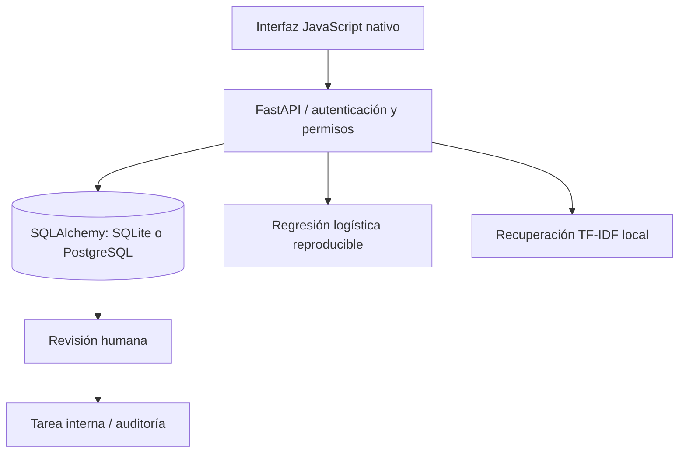

# Arquitectura y decisiones de diseño

## Separación de responsabilidades
- `app/models.py`: organizaciones, usuarios, prospectos, revisiones, tareas y auditoría.
- `app/intelligence.py`: datos sintéticos, entrenamiento, evaluación, inferencia explicable, recuperación de conocimiento y política de recomendaciones.
- `app/main.py`: validación Pydantic, autenticación, autorización por rol, aislamiento organizacional, transacciones, endpoints y políticas HTTP.
- `app/provision.py`: creación local de cuentas y registros demo, sin registro público.
- `app/static/`: interfaz nativa sin dependencias de paquetes frontend.

## Invariantes
Toda consulta a una entidad de negocio está restringida por `org_id`. Los tokens contienen identidad, no permisos confiados desde el cliente; el rol se lee de la base de datos. Las contraseñas se hashean con Argon2id. La edición exige una revisión coincidente. Cada revisión de prospecto tiene como máximo una propuesta, cada propuesta aprobada como máximo una tarea. La decisión es condicional al estado pendiente. La actualización del prospecto invalida propuestas y revocar permiso o cerrar el registro cancela tareas abiertas. PostgreSQL tiene bloqueos de fila expresados en SQLAlchemy; su comportamiento concurrente todavía no se ha validado. SQLite se usa para las pruebas locales.

## Límites
El dashboard lee todos los registros del espacio para calcular el scoring; para grandes volúmenes conviene precalcular scores versionados, construir agregaciones y paginar. Auditoría de aplicación no equivale a almacenamiento inmutable. No existe autorización por propietario individual del prospecto, solo organización y rol. No hay eliminación/anonimización ni retención configurable. No hay integración real ni mensajería. La búsqueda de la interfaz se limita a la página actual y el resumen prioritario a 200 registros recientes.
